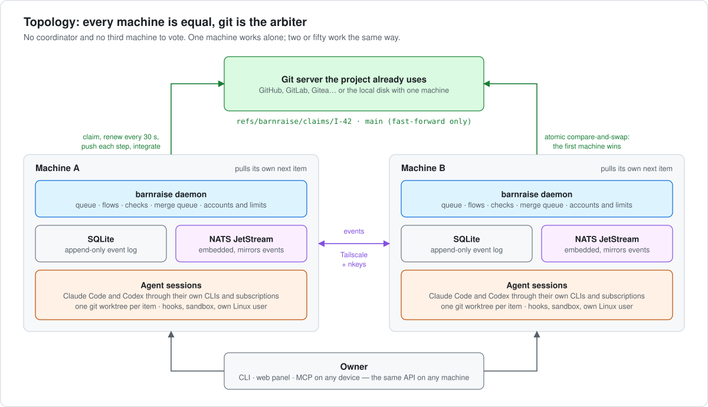
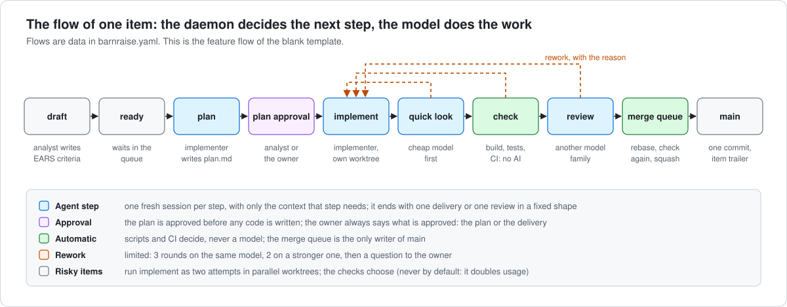
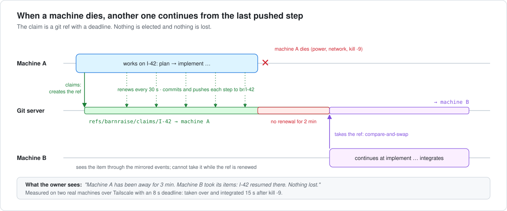
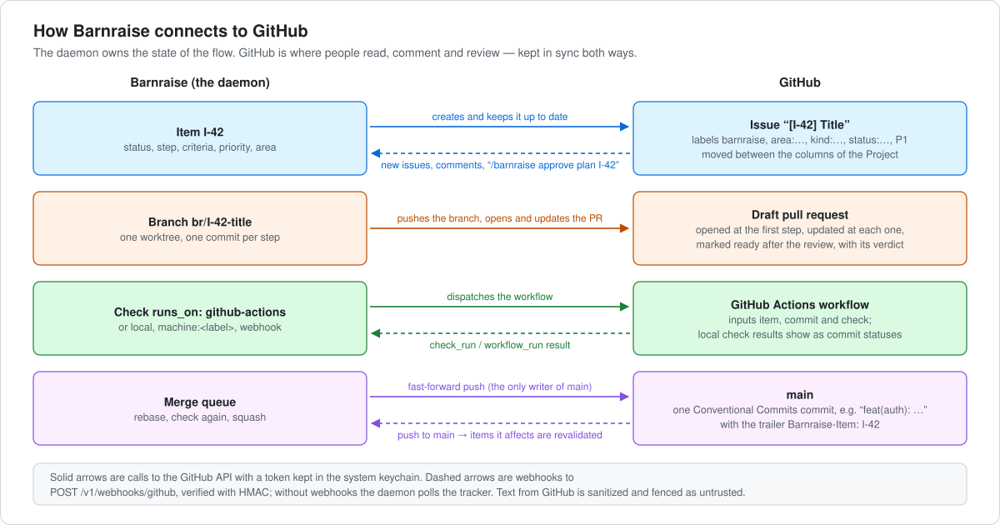

# Barnraise

Barnraise is one Go binary that drives a software project with AI coding agents, from the queue to the commit on main. It runs Claude Code, Codex and the Gemini CLI through their own CLIs and subscriptions and takes care of everything around them: which item comes next, the steps each item goes through, checks, reviews, the merge queue, accounts and limits, several machines, and security.

The name comes from "barn raising": neighbours building a barn together in a day.

> Status: 0.1.0, unreleased. See [CHANGELOG.md](CHANGELOG.md). Leia em português: [docs/README.pt-BR.md](docs/README.pt-BR.md).



## What you get

- **A queue that ends.** Every goal has a measurable end. Agents propose work, but proposals have a daily limit, expire and need approval, so the queue does not grow by itself.
- **The flow is code, not a prompt.** The daemon decides the next step, the rework and the integration. The model only does the work of the step it is in.
- **Verification that a model cannot talk its way past.** Criteria are tied to checks (build, tests, CI). A review runs on a different model from the implementation. Only the merge queue writes to main.
- **Your subscriptions, used well.** Several accounts per provider with their real limits, a cheap model for cheap steps, and only the context each step needs.
- **Several machines without a server.** Every machine is equal. Git decides who holds an item; when a machine dies, another continues from the last pushed step.
- **Safe by construction, so agents never ask for permission.** The barrier is the operating system and the daemon: a blocking hook, a sandbox or a container, a separate Linux user, a restricted network. Not a sentence in a prompt, and not a prompt on your screen.

## How it compares

Barnraise does not replace these tools; several of them inspired it, and Claude Code and Codex run inside it. The difference is what each one is responsible for.

| If you use | It gives you | What Barnraise does differently |
| --- | --- | --- |
| **Claude Code or Codex alone** (subagents, agent teams, background sessions) | Very good work inside one session. Teams of agents run on the account of the session that leads them | Uses the CLI as it is (hooks, sandbox, status line) and adds what a session does not have: a queue, a flow per item, several accounts, several machines, a merge queue |
| **Session managers** ([claude-squad](https://github.com/smtg-ai/claude-squad), [ccmanager](https://github.com/kbwo/ccmanager), [uzi](https://github.com/devflowinc/uzi)) | Several sessions side by side, one worktree each. You tell each session what to do | Decides what each session does next. You approve plans, answer questions and read the result |
| **Agents that coordinate agents** ([Gas Town](https://github.com/gastownhall/gastown) with [Beads](https://github.com/gastownhall/beads)) | A mayor splits the work, workers run it, watchers look for stuck agents, a refinery merges | Coordination and supervision are Go code, not agents, so they cost no tokens and cannot drift. Agents never change the orchestrator or its rules |
| **Flow engines** ([LoopForge](https://github.com/Tencent/LoopForge)) | Flows as graphs with agent, script and approval steps; a Docker sandbox per run | The same idea of flows as data, but isolation by Linux user and native sandbox, so emulators and local tools keep working; and no central server |
| **Spec-first kits** ([Spec Kit](https://github.com/github/spec-kit), [Kiro](https://kiro.dev/docs/specs/)) | A constitution, a specification and a plan before the code; criteria in EARS | Keeps the EARS criteria and the approved plan, ties each criterion to a check, and goes on after the plan: implementation, review, integration |
| **In-session discipline** ([superpowers](https://github.com/obra/superpowers)) | Fixed delivery statuses, reviews with two verdicts, limited rework, enforced by instructions | The same shapes, validated by the daemon. Loose text does not move an item |
| **Hosted agents** (Codex cloud and similar) | Parallel attempts in the vendor's cloud | Runs on your machines with your subscriptions and your emulators; two attempts only for items marked risky |

Choose Barnraise when the project is larger than one session: many items, more than one account or machine, and a main branch that must stay green without you reading every diff. For a single change in a single session, the CLI alone is enough.

## Quick start

Requirements: Linux or macOS, `git`, and at least one AI CLI you are logged in to (`claude`, `codex` or `gemini`). `bwrap` (bubblewrap) is used when present; Tailscale is built into the release binaries.

```sh
curl -fsSL https://raw.githubusercontent.com/leandrodaf/barnraise/main/install.sh | sh

cd your-repo
barnraise init                 # connect accounts, talk about the project, write barnraise.yaml
barnraise up                   # register the project and start the daemon of this machine

barnraise item add "Sign-in screen" \
  -c "WHEN the user taps Sign in with valid credentials, THE SYSTEM SHALL show the home screen | main" \
  --area auth

barnraise status               # goal, focus, queue, agents, accounts and machines in one look
```

| Command | What it does |
| --- | --- |
| `barnraise goal set "<name>" --done-when "<end>"` | Set the goal with a measurable end |
| `barnraise focus <area> --until done` | Point most of the capacity at one area for a while |
| `barnraise approve I-7 --plan` | Approve the plan of an item (`--delivery` for the delivery) |
| `barnraise questions` / `barnraise answer` | What agents asked the owner, and the answers |
| `barnraise events -f` | Follow every event live |
| `barnraise pause` / `barnraise resume` | Emergency button for every agent of a project (`--all`: every project of the daemon) |
| `barnraise standby on` / `off` | This machine's switch: the daemon runs but starts nothing here, kept across restarts and settable with the daemon stopped |
| `barnraise account add claude` | Add another subscription account to the rotation |
| `barnraise account add openrouter` | Add an API-key account (OpenRouter, or a provider under `providers:`) for cheap steps and research; the key goes to the keychain |
| `barnraise account add <name>` | Add an account of any agent that speaks the Agent Client Protocol, declared as `type: acp` under `providers:`; its permission requests, files and terminals go through Barnraise's policy |

Every command prints text for people by default and JSON with `--json`. The web panel is served by the daemon at `http://127.0.0.1:7420/`; the desktop app (`make desktop`) opens the same panel and can start the daemon or reach another machine ([ADR-0045](docs/adr/0045-panel-and-desktop-app.md)). To work on the panel: `cd web && pnpm dev` (it talks to the local daemon), and `make desktop-dev` for the app with live reload.

## How an item moves



- An **item** is one deliverable unit of work, sized for 2 to 6 hours of agent time, with criteria in EARS form, each tied to a check. An item without criteria stays a draft until the analyst refines it.
- Each **step** is one fresh session that receives only the context of that step, and ends with one delivery or one review in a fixed shape.
- Each item has its own **branch, worktree and draft pull request** from the first step. Every step ends with a commit and a push, so nothing is lost if a machine dies.
- A failed quick look, check or review sends the item back with the reason. **Rework is limited**; past the limit the owner gets a question instead of an endless loop.
- A **bug** has its own flow: it only closes with a test that fails on main and passes on the branch.
- Each item lands as **one commit in the Conventional Commits form and one line in the changelog** (Keep a Changelog), written from the same description and always in English, whatever language the project's people read.

Flows, roles and checks are data in `barnraise.yaml`, merged over a template (`mobile-android`, `backend`, `web`, `content`, `blank`).

## One repository, several parts

A repository with a Go backend, a React web app and a React Native app is one project with three parts. Each part carries its own `barnraise.yaml` in its folder; Barnraise finds them by itself, and `barnraise init` writes them.

```yaml
# backend/barnraise.yaml                      # mobile/barnraise.yaml
about: REST API                               about: Mobile app, Android first
stack: go                                     stack: react-native
checks:                                       kinds: { feature: feature-mobile }
  lint: { run: golangci-lint run, order: 1 }  checks:
  test: { run: go test ./..., order: 2 }        test: pnpm run test
```

- **Only what the change touches is checked.** A backend item runs the backend checks, inside `backend/`. Web and mobile checks are skipped, and the timeline says why.
- **Unknown ground runs everything.** A file that belongs to no part, or one you list in `selection.all_when` (a `Makefile`, a `go.mod`), runs every check. Files in `selection.none_when` (docs, the backlog) need none.
- **No repeated work.** A check may cover another (`covers`), cheap checks run first and the step stops at the first failure, and the merge queue does not check again a tree that was already checked.
- **New dependencies are checked for known vulnerabilities.** A change to a lockfile or manifest is looked up in [OSV](https://osv.dev) before it integrates (with osv-scanner when installed, the OSV API otherwise); only what the change brings in counts, and a finding at or above `dependencies.fail_at` goes back to the agent. See [docs/configuration.md](docs/configuration.md#dependencies).
- **Each part may behave differently.** A part chooses the flow of its items (`kinds`) and the machines its checks need (`runs_on: machine:emulators`). Agents are told which part they work in and which ones are not theirs to change.

`barnraise check --touched mobile/src/Home.tsx` shows which checks would run for a change. Details in [docs/configuration.md](docs/configuration.md#several-parts-in-one-repository).

## Several machines

Every machine runs the same binary and pulls its own next item. There is no coordinator to elect and no third machine to vote.

- **Git is the arbiter.** Taking an item creates `refs/barnraise/claims/<item>` with an atomic compare-and-swap; the first machine wins. Main only moves by fast-forward push.
- **Events are mirrored.** Each machine has its own embedded NATS JetStream; events flow between machines whenever they can see each other, and each machine keeps working when isolated.
- **Pairing takes a 6-digit code.** `barnraise machine invite` on one machine, `barnraise machine join <code>` on the other. Each machine has its own nkey and may only read the other's events.
- **Tailscale is built in.** The release binaries embed Tailscale: Barnraise joins the tailnet as its own device, named after the machine and tagged `tag:barnraise`, so a machine needs nothing but `barnraise`. Give it an auth key once (`barnraise machine network-key`, or `BARNRAISE_TS_AUTHKEY`) and `barnraise machine join 482913` joins the tailnet and the cluster at once, finding the inviting machine among the tailnet's Barnraise machines. An installed `tailscale` is used instead when there is one; `barnraise machine network tsnet --control-url <url>` points the embedded one at a self-hosted Headscale. Without Tailscale the same code pairs over the local network or a direct address (`--addr`). See [operations.md](docs/operations.md#machines-on-a-tailnet).
- **Any other network through a plugin.** ZeroTier, Nebula, a Headscale client, plain WireGuard or a company VPN: a [network plugin](docs/plugins.md#network), a small program in any language, tells Barnraise this machine's address and the other machines' names, addresses and online state, and the overlay carries the traffic. `barnraise machine network plugin --command <program>`, no rebuild; [examples/plugins/network-static.py](docs/examples/plugins/network-static.py) reads the machines from a file.
- **One version.** A machine that sees a peer with a newer version fetches the binary, verifies its hash and restarts while no session runs.
- **Machines know each other's load.** Each one reports CPU, memory, temperature and GPU, as live state that is never stored. A loaded machine hands its checks to an idle one, which cleans up after itself; `barnraise machine history` draws the recent readings.
- **Each machine says what runs there.** `barnraise capabilities --all` lists, per machine, every feature that depends on it (Landlock, bubblewrap, microVM, the egress broker, mergiraf, rtk, osv-scanner, ast-grep, copy-on-write caches, provider logins…) as active, available, degraded or missing, with the reason, the fallback and the exact fix; `barnraise tools install mergiraf rtk --all` installs the optional tools without root, at pinned versions checked against their sha256. See [operations.md](docs/operations.md#what-runs-on-each-machine).



`barnraise cluster status` shows each machine in green, yellow or red. `barnraise machine leave` gives this machine's items back before leaving.

## GitHub

The daemon owns the state of the flow. GitHub is where people read, comment and review, and it stays in sync both ways.



| In Barnraise | On GitHub | Sync |
| --- | --- | --- |
| Item `I-42` | Issue `[I-42] Title`, labels `barnraise`, `area:…`, `kind:…`, `status:…`, priority; column of the Project | Barnraise creates and updates the issue and keeps the labels people added. New issues become items: directly from `tracker.trusted` authors or labels, through the analyst otherwise |
| Branch `br/I-42-title` | Draft pull request | Opened at the first step, updated at each one, marked ready after the review, which is posted on it |
| Check with `runs_on: github-actions` | Actions workflow | Dispatched with the inputs `item`, `commit` and `check`; the result comes back through the [check action](action/check) or the webhook. Local check results show as commit statuses |
| Merge queue | `main` | Rebase, check again, one squash commit `I-42: Title` with the trailer `Barnraise-Item: I-42` |
| Approval | Issue comment | `/barnraise approve plan I-42` from a trusted author approves the plan |

Set it up:

```sh
barnraise tracker connect github             # stores the token in the system keychain
barnraise webhook secret github --generate   # optional: webhooks instead of polling
```

```yaml
tracker:
  type: github
  repo: owner/name
  project: 3                # GitHub Projects number, optional
  trusted: [owner-login]    # their issues become items without the analyst
checks:
  ui:
    runs_on: github-actions
    workflow: ui-tests.yml
```

Without a stored token, Barnraise uses `GITHUB_TOKEN` and then `gh auth token`. Without webhooks it polls the tracker; with them (`POST /v1/webhooks/github`, verified with the HMAC signature, events `push`, `issues`, `issue_comment`, `check_run`, `workflow_run`) changes arrive at once. Text that comes from GitHub is sanitized and shown to agents inside fences as untrusted data. "Issue" is only the thing on GitHub: item I-42 shows up as issue #1608. GitLab, Jira and Linear work the same way as trackers; see [docs/configuration.md](docs/configuration.md).

Any other tracker, check runner, notification channel or event hook is an external plugin: a program in any language that speaks JSON-RPC on its standard input and output, declared under `plugins:` in `barnraise.yaml` and used as `tracker: {type: plugin:<name>}`, `runs_on: plugin:<name>` or `type: plugin:<name>` in `notifications`. No rebuild of Barnraise is needed; see [docs/plugins.md](docs/plugins.md).

## Security

Agents read untrusted text, could reach private data and could send data out. Barnraise breaks all three, in layers. Details in [docs/security.md](docs/security.md).

1. **Secrets** live in the system keychain, never in YAML or in the repository.
2. **One Linux user per agent account** (`barnraise account add --isolate`), without access to the owner's home.
3. **A blocking hook** before every tool call, decided locally from a compiled policy: no writes to workflows, `.barnraise/`, `.env*` or existing tests; no push to main, `sudo` or `curl | sh`. It works even when the CLI runs without permission prompts.
4. **A sandbox or a container**: Claude Code's native sandbox when `bwrap` works on the machine, Codex in `workspace-write`, and the Gemini CLI as a reader without shell or write tools; or, with `container:` in `barnraise.yaml`, every session inside a container that sees only the item's worktree, with the machine's GPU passed in by default.
5. **Restricted network**: an allow-list proxy and `nftables` rules per agent user.
6. **Only the tools you allow in a session**: Barnraise's own MCP server plus the ones listed under `mcp:` in `barnraise.yaml`, per role. The account owner's own MCP servers, plugins and personal settings are not loaded.
7. **Permission by role in the daemon**: an implementer has no `approve` scope and never sees the tool.
8. **A secret scan before every push**, scoped API tokens, an audit log, signed webhooks.

## Concepts

One word per concept, the same in the CLI, the YAML, the panel and the docs. A test (`internal/archtest`) fails on words outside this vocabulary.

| Concept | What it is | Command or field |
| --- | --- | --- |
| Project | A repository Barnraise drives, with its `barnraise.yaml` | `barnraise init` |
| Goal | The long-term result, with a measurable end | `goal:`, `barnraise goal set` |
| Focus | A temporary priority inside the goal | `barnraise focus` |
| Item | One deliverable unit of work, 2 to 6 hours of agent time | `barnraise item` |
| Criterion | An acceptance condition in EARS, tied to a check | `-c` of `item add` |
| Proposal | A suggested item, waiting for approval | `barnraise propose` |
| Tweak | A small fix that rides with the next item of the same area | `barnraise tweak add` |
| Area | A screen, module or folder; groups tweaks and proposals | `areas:` |
| Flow | The sequence of steps of an item kind | `flows:` |
| Step | One part of a flow: plan, implement, check, review, integrate | `steps:` |
| Check | An automatic verification: build, tests, screenshots | `checks:` |
| Review | An evaluation by an agent or a person, with two verdicts | `barnraise review` |
| Rework | A return to an earlier step, with a limit | `rework:` |
| Delivery | What the agent hands back at the end of a step, with a fixed status | `barnraise deliver` |
| Role | A function: implementer, reviewer, analyst, designer | `roles:` |
| Agent | A role running on an account, on a machine | `barnraise agents` |
| Account | A login at a provider | `barnraise account add` |
| Provider | Claude Code, Codex, Gemini CLI, … | `models:` |
| Machine | A computer of the cluster; all are equal, none is central | `barnraise machine invite` |
| Tracker | Where people see items: local, GitHub, GitLab, Jira, Linear | `tracker:` |
| Template | Ready roles, flows and checks for a kind of project | `template:` |
| Owner | The person who approves and decides | `approves: owner` |
| Merge queue | Where approved items wait to land on main | `barnraise queue` |
| Anchor | What an item assumes: files, symbols, contracts, decisions, the base commit | `--files`, `--symbols` |
| Revalidation | Checking whether an item still holds after something changed | `barnraise revalidate` |

Short ids are the same everywhere (tracker, pull request title, branch, commit trailer): `G-3` goal, `I-142` item, `P-77` proposal, `D-12` decision. `git log --grep I-142` finds all the code of an item.

## Inside

**The daemon is the only authority**: only it writes state, touches main and decides transitions. The CLI, the MCP server, the provider hooks, the web panel and any external system are clients of the same API ([docs/api.md](docs/api.md): Connect RPC from protobuf, answering gRPC and plain JSON over HTTP, with OpenAPI, live events as CloudEvents, signed webhooks and scoped tokens).

State is an append-only event log in SQLite; the current state is derived from the events, so there is full history and any step can be redone. The repository of a project holds only configuration (`barnraise.yaml` and `.barnraise/`), never state and never secrets.

The code is hexagonal, and the dependency rule is enforced by the linter:

```
cmd/barnraise/            composition root: wires adapters to ports, one binary
internal/domain/          pure rules: item, goal, focus, flow, rework, capacity, policy (stdlib only)
internal/app/             use cases: claim, deliver, review, integrate, propose, set focus…
internal/ports/           small interfaces: Provider, Tracker, CodeHost, Arbiter, EventBus, StateStore…
internal/adapters/in/     httpapi (Connect), mcp, cli, hooks, panel
internal/adapters/out/    claude, codex, gemini, github, gitlab, jira, linear, plugin, nats, sqlite, git, tailnet, pairing…
proto/ · gen/             the API contract (protobuf) and the generated code
templates/                base defaults and the project templates
docs/adr/                 architecture decision records
```

## Configuration

`barnraise init` writes a short `barnraise.yaml` that keeps only what differs from its template. `barnraise explain` shows everything in effect and `barnraise check` finds mistakes in plain sentences.

```yaml
template: mobile-android
goal: Personal finance app, Android first
approves: owner
checks:
  main: scripts/verify.py
```

The full reference is [docs/configuration.md](docs/configuration.md). Operations (systemd, container image, headless servers, backups, upgrades) are in [docs/operations.md](docs/operations.md).

## Development

Requirements: Go 1.27 and `git`; for the contract, `buf` with `protoc-gen-go`, `protoc-gen-connect-go` and `protoc-gen-connect-openapi`.

| Target | What it runs |
| --- | --- |
| `make build` | Builds `./barnraise` |
| `make test` | Fast tests |
| `make test-race` | The full suite with the race detector, including end-to-end and cluster tests |
| `make cover` | Coverage; fails when `internal/domain` or `internal/app` is below 90% |
| `make lint` · `make vuln` | `golangci-lint` (with the architecture rules) · `govulncheck` |
| `make smoke` | From `init` to one integrated item on a scratch repository (`SMOKE_PROVIDER=claude` uses a real account) |
| `make proto` · `make proto-breaking` | `buf generate` · `buf breaking` against main |

Tests run against real git, real embedded NATS and SQLite, recorded provider sessions, and a scripted fake provider for the end-to-end and cluster tests. Contributions: [CONTRIBUTING.md](CONTRIBUTING.md). Security reports: [SECURITY.md](SECURITY.md).

## License

Apache License 2.0. See [LICENSE](LICENSE).
