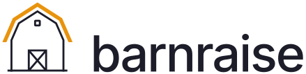
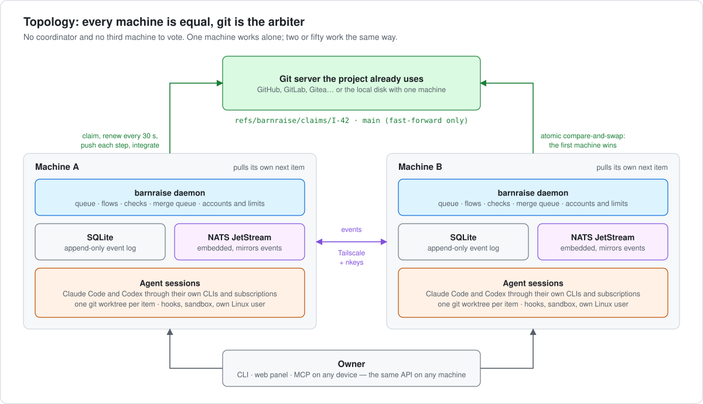
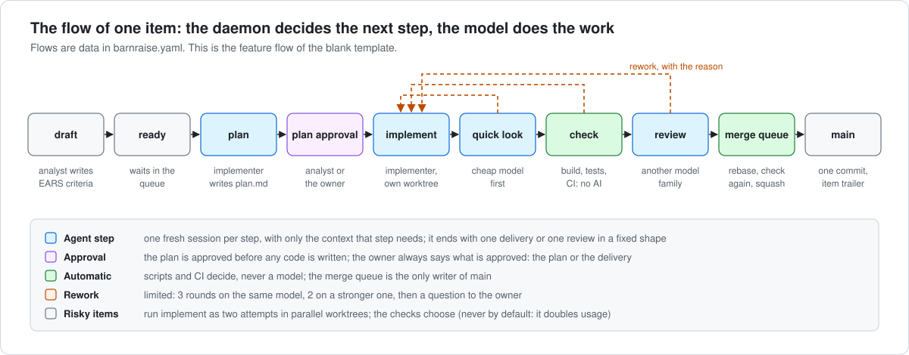
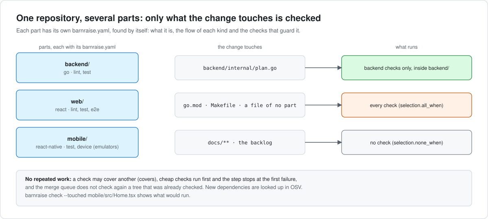
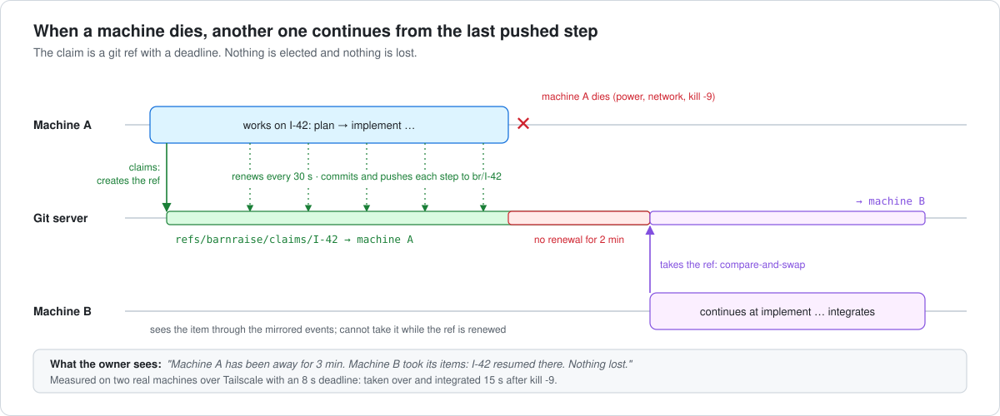
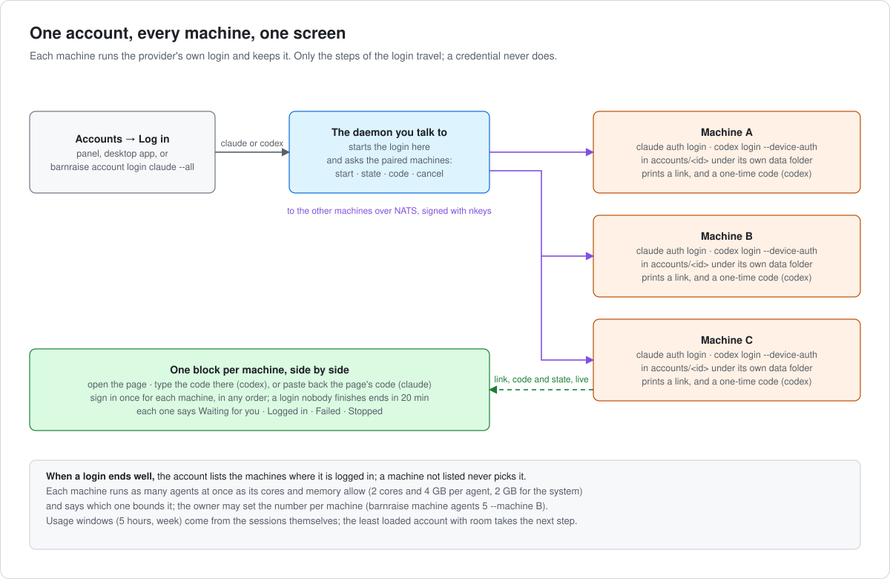
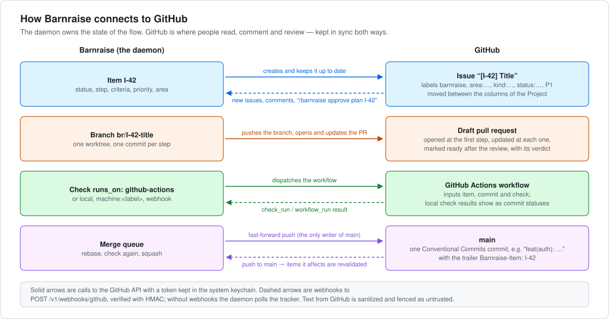

<h1>
  <picture>
    <source media="(prefers-color-scheme: dark)" srcset="../assets/brand/svg/logo-on-dark.svg">
    
  </picture>
</h1>

O Barnraise é um binário único em Go que toca um projeto de software com agentes de IA, da fila até o commit na main. Ele roda o Claude Code, o Codex e a Gemini CLI pelas CLIs e assinaturas deles e cuida de tudo em volta: qual item vem agora, as etapas de cada item, verificações, revisões, a fila de integração, contas e limites, várias máquinas e segurança.

O nome vem de *barn raising*: os vizinhos levantando um celeiro juntos num dia.

> Estado: 0.1.0, o primeiro lançamento. Veja o [CHANGELOG.md](../CHANGELOG.md). Read in English: [README.md](../README.md).

Este arquivo está em português porque a regra é a do próprio Barnraise: o que vai para pessoas sai na língua delas. Código, CLI, chaves do yaml, prompts internos e os diagramas ficam em inglês.



## O que você ganha

- **Uma fila que termina.** Todo objetivo tem um fim mensurável. Os agentes propõem trabalho, mas as propostas têm limite diário, expiram e precisam de aprovação; a fila não cresce sozinha.
- **O fluxo é código, não prompt.** O daemon decide a próxima etapa, o retrabalho e a integração. O modelo só faz o trabalho da etapa em que está.
- **Verificação que o modelo não contorna na conversa.** Os critérios são ligados a verificações (build, testes, CI). A revisão roda num modelo diferente do que implementou. Só a fila de integração escreve na main.
- **Suas assinaturas, bem usadas.** Várias contas por provedor com os limites reais, modelo barato nas etapas baratas e só o contexto de que cada etapa precisa.
- **Várias máquinas sem servidor.** Toda máquina é igual. O git decide quem fica com um item; se uma máquina cai, outra continua da última etapa enviada.
- **Seguro por construção, então os agentes nunca pedem permissão.** A barreira é o sistema operacional e o daemon: hook que bloqueia, sandbox ou container, usuário Linux separado, rede restrita. Não é uma frase no prompt, nem uma pergunta na sua tela.

## De/para: como se compara

O Barnraise não substitui estas ferramentas; várias inspiraram o projeto, e o Claude Code e o Codex rodam dentro dele. A diferença está no que cada uma assume.

| Se você usa | O que ela te dá | O que o Barnraise faz diferente |
| --- | --- | --- |
| **Claude Code ou Codex sozinhos** (subagentes, times de agentes, sessões em segundo plano) | Trabalho muito bom dentro de uma sessão. Os times de agentes rodam na conta da sessão que lidera | Usa a CLI como ela é (hooks, sandbox, status line) e acrescenta o que uma sessão não tem: fila, fluxo por item, várias contas, várias máquinas, fila de integração |
| **Gerenciadores de sessão** ([claude-squad](https://github.com/smtg-ai/claude-squad), [ccmanager](https://github.com/kbwo/ccmanager), [uzi](https://github.com/devflowinc/uzi)) | Várias sessões lado a lado, um worktree para cada. Você diz a cada sessão o que fazer | Decide o que cada sessão faz em seguida. Você aprova planos, responde perguntas e lê o resultado |
| **Agentes coordenando agentes** ([Gas Town](https://github.com/gastownhall/gastown) com [Beads](https://github.com/gastownhall/beads)) | Um prefeito divide o trabalho, operários executam, vigias procuram agente travado, uma refinaria integra | Coordenação e vigilância são código Go, não agentes: não gastam tokens e não saem do rumo. O agente nunca mexe no orquestrador nem nas regras dele |
| **Motores de fluxo** ([LoopForge](https://github.com/Tencent/LoopForge)) | Fluxos em grafo com etapas de agente, script e aprovação; sandbox Docker por execução | A mesma ideia de fluxo como dado, mas com isolamento por usuário Linux e sandbox nativo, então emuladores e ferramentas locais continuam funcionando; e sem servidor central |
| **Kits de especificação** ([Spec Kit](https://github.com/github/spec-kit), [Kiro](https://kiro.dev/docs/specs/)) | Constituição, especificação e plano antes do código; critérios em EARS | Mantém os critérios EARS e o plano aprovado, liga cada critério a uma verificação e segue depois do plano: implementação, revisão, integração |
| **Disciplina dentro da sessão** ([superpowers](https://github.com/obra/superpowers)) | Status de entrega fixos, revisão com dois vereditos, retrabalho limitado, garantidos por instruções | Os mesmos formatos, validados pelo daemon. Texto solto não move um item |
| **Agentes hospedados** (Codex cloud e parecidos) | Tentativas em paralelo na nuvem do fornecedor | Roda nas suas máquinas, com as suas assinaturas e os seus emuladores; duas tentativas só em item marcado como de risco |

Escolha o Barnraise quando o projeto é maior que uma sessão: muitos itens, mais de uma conta ou máquina, e uma main que precisa ficar verde sem você ler cada diff. Para uma mudança única numa sessão única, a CLI sozinha basta.

## Começo rápido

Requisitos: Linux ou macOS, `git` e pelo menos uma CLI de IA em que você esteja logado (`claude`, `codex` ou `gemini`). O Tailscale e o `bwrap` (bubblewrap) são usados quando existem.

```sh
curl -fsSL https://raw.githubusercontent.com/leandrodaf/barnraise/main/install.sh | sh

cd seu-repo
barnraise init                 # conecta as contas, conversa sobre o projeto e escreve o barnraise.yaml
barnraise up                   # registra o projeto e sobe o daemon desta máquina

barnraise item add "Tela de login" \
  -c "WHEN the user taps Sign in with valid credentials, THE SYSTEM SHALL show the home screen | main" \
  --area auth

barnraise status               # objetivo, foco, fila, agentes, contas e máquinas de uma vez
barnraise panel                # o painel web no navegador, já com a sessão iniciada
```

| Comando | O que faz |
| --- | --- |
| `barnraise goal set "<nome>" --done-when "<fim>"` | Define o objetivo com um fim mensurável |
| `barnraise focus <área> --until done` | Aponta a maior parte da capacidade para uma área por um tempo |
| `barnraise approve I-7 --plan` | Aprova o plano de um item (`--delivery` para a entrega) |
| `barnraise questions` / `barnraise answer` | O que os agentes perguntaram ao dono, e as respostas |
| `barnraise events -f` | Acompanha todos os eventos ao vivo |
| `barnraise pause` / `barnraise resume` | Botão de emergência para todos os agentes de um projeto (`--all`: todos os projetos do daemon) |
| `barnraise standby on` / `off` | Chave da máquina: o daemon roda, mas não inicia nada nela; vale entre reinícios e pode ser ligada com o daemon parado |
| `barnraise panel` | Abre o painel web no navegador, já com a sessão iniciada (`--print` escreve o endereço) |
| `barnraise account add claude` | Põe outra conta de assinatura na rotação |
| `barnraise account login claude --all` | Entra com uma conta em todas as máquinas conectadas ao mesmo tempo; o painel faz o mesmo em Contas |
| `barnraise machine agents 5 --machine studio` | Quantos agentes uma máquina roda ao mesmo tempo (`auto`: medido pelos núcleos e pela memória) |
| `barnraise account add openrouter` | Põe uma conta por chave de API (OpenRouter, ou um provedor em `providers:`) para passos baratos e pesquisa; a chave vai para o chaveiro |
| `barnraise account add <nome>` | Põe uma conta de qualquer agente que fale o Agent Client Protocol, declarado como `type: acp` em `providers:`; os pedidos de permissão, os arquivos e os terminais dele passam pela política do Barnraise |

Todo comando imprime texto para pessoas por padrão e JSON com `--json`. O painel web é servido pelo daemon em `http://127.0.0.1:7420/`, e o `barnraise panel` abre com a sessão iniciada (o token do dono fica em `~/.config/barnraise/owner.token`); o app desktop (`make desktop`) abre o mesmo painel e pode iniciar o daemon ou alcançar outra máquina ([ADR-0045](adr/0045-panel-and-desktop-app.md)). No Linux, `make desktop desktop-install` o coloca no menu de aplicativos com o ícone; no macOS, `make desktop` gera `desktop/build/bin/Barnraise.app`, com o barnraise dentro, para arrastar para Aplicativos. Para mexer no painel: `cd web && pnpm dev` (ele fala com o daemon local), e `make desktop-dev` para o app com recarga ao vivo.

## Suas decisões, num lugar só


- **Tudo o que espera você chega numa tela só**: as perguntas que os agentes não conseguiram responder sozinhos, os planos e as entregas para aprovar, e as propostas. O Início do painel começa por elas; cada parte do repositório diz o que espera, e cada uma pode ser respondida ali mesmo.
- **Converse antes de responder.** O conselheiro é uma sessão no modelo mais forte do projeto que lê o item, a pergunta, o que os agentes fizeram e o código, e nunca altera nada. Você acompanha ao vivo o que ele lê e busca, e ele termina com uma resposta sugerida: confirme, edite ou pergunte mais.
- **Ou deixe ele decidir.** *Decidir por mim* faz o conselheiro responder uma pergunta ou decidir uma proposta; a conversa guarda o que ele escolheu e por quê, marcado como delegado.
- **Propostas de uma vez.** *Triar com o conselheiro* lê todas as propostas abertas e diz aprovar, recusar ou depois para cada uma, com uma frase; nada é aplicado até você manter as que concorda.
- **Suas palavras seguem junto.** O que você disse enquanto decidia vai, com as suas palavras, para o próximo agente que trabalhar no item.

## Como um item anda



- Um **item** é uma unidade de trabalho entregável, do tamanho de 2 a 6 horas de agente, com critérios em EARS, cada um ligado a uma verificação. Item sem critério fica como rascunho até o analista refinar.
- Cada **etapa** é uma sessão nova, que recebe só o contexto daquela etapa e termina com uma entrega ou uma revisão em formato fixo.
- Cada item tem **branch, worktree e pull request em rascunho** próprios desde a primeira etapa. Toda etapa termina com commit e push; se a máquina cair, nada se perde.
- Revisão rápida, verificação ou revisão que falha devolve o item com o motivo. **O retrabalho tem limite**; passou do limite, o dono recebe uma pergunta em vez de um laço sem fim.
- **Bug** tem fluxo próprio: só fecha com um teste que falha na main e passa na branch.
- Cada item entra como **um commit no formato Conventional Commits e uma linha no changelog** (Keep a Changelog), escritos da mesma descrição e sempre em inglês, seja qual for a língua das pessoas do projeto.

Fluxos, papéis e verificações são dados no `barnraise.yaml`, por cima de um modelo de projeto (`mobile-android`, `backend`, `web`, `content`, `blank`).

## Um repositório, várias partes

Um repositório com backend em Go, web em React e app em React Native é um projeto com três partes. Cada parte leva o seu próprio `barnraise.yaml` na pasta dela; o Barnraise acha esses arquivos sozinho, e o `barnraise init` escreve.



```yaml
# backend/barnraise.yaml                      # mobile/barnraise.yaml
about: REST API                               about: Mobile app, Android first
stack: go                                     stack: react-native
checks:                                       kinds: { feature: feature-mobile }
  lint: { run: golangci-lint run, order: 1 }  checks:
  test: { run: go test ./..., order: 2 }        test: pnpm run test
```

- **Só se verifica o que a mudança toca.** Um item do backend roda as verificações do backend, dentro de `backend/`. As de web e mobile são puladas, e a linha do tempo diz por quê.
- **Terreno desconhecido roda tudo.** Arquivo que não pertence a nenhuma parte, ou que você listou em `selection.all_when` (um `Makefile`, um `go.mod`), roda todas as verificações. Arquivos em `selection.none_when` (documentação, backlog) não exigem nenhuma.
- **Sem trabalho repetido.** Uma verificação pode cobrir outra (`covers`), as baratas rodam primeiro e a etapa para na primeira falha, e a fila de integração não verifica de novo uma árvore que já foi verificada.
- **Dependências novas são verificadas contra vulnerabilidades conhecidas.** Uma mudança num lockfile ou manifesto é consultada no [OSV](https://osv.dev) antes de integrar (com o osv-scanner quando instalado, a API do OSV caso contrário); só conta o que a mudança traz, e um achado igual ou acima de `dependencies.fail_at` volta para o agente. Veja [configuration.md](configuration.md#dependencies).
- **Cada parte pode se comportar de um jeito.** A parte escolhe o fluxo dos itens dela (`kinds`) e as máquinas de que as verificações precisam (`runs_on: machine:emulators`). Os agentes ficam sabendo em que parte estão trabalhando e quais não são deles.

`barnraise check --touched mobile/src/Home.tsx` mostra quais verificações rodariam para uma mudança. Detalhes em [configuration.md](configuration.md#several-parts-in-one-repository).

## Várias máquinas

Toda máquina roda o mesmo binário e puxa o próprio próximo item. Não há coordenador para eleger nem terceira máquina para votar.

- **O git é o árbitro.** Pegar um item cria `refs/barnraise/claims/<item>` com um compare-and-swap atômico; a primeira máquina ganha. A main só anda por push fast-forward.
- **Os eventos são espelhados.** Cada máquina tem seu NATS JetStream embutido; os eventos correm entre as máquinas sempre que elas se enxergam, e cada uma continua trabalhando quando fica isolada.
- **Parear leva um código de 6 dígitos.** `barnraise machine invite` numa máquina, `barnraise machine join <código>` na outra. Cada máquina tem sua nkey e só pode ler os eventos da outra.
- **O Tailscale vem embutido.** Os binários de release trazem o Tailscale: o Barnraise entra na tailnet como um dispositivo próprio, com o nome da máquina e a tag `tag:barnraise`, e a máquina não precisa de mais nada além do `barnraise`. Com uma auth key (`barnraise machine network-key` ou `BARNRAISE_TS_AUTHKEY`), `barnraise machine join 482913` entra na tailnet e no cluster de uma vez. Um `tailscale` instalado é usado no lugar quando existe; `barnraise machine network tsnet --control-url <url>` aponta para um Headscale próprio. Sem Tailscale, o mesmo código pareia pela rede local ou por um endereço direto (`--addr`).
- **Uma versão só.** A máquina que vê outra com versão mais nova baixa o binário, confere o hash e reinicia quando não há sessão rodando.
- **As máquinas conhecem a carga umas das outras.** Cada uma informa CPU, memória, temperatura e GPU, como estado ao vivo que nunca é gravado. A máquina carregada passa as verificações para uma ociosa, que limpa o que criou; `barnraise machine history` desenha as leituras recentes.
- **Cada máquina diz quantos agentes roda, e por quê.** Por padrão, 2 núcleos e 4 GB de memória por agente, com 2 GB reservados para o sistema; o painel diz qual dos dois limita cada máquina, e o dono define outro número por máquina com − e + (ou `barnraise machine agents`).
- **Cada máquina diz o que roda nela.** `barnraise capabilities --all` e a tela de Capacidades começam pelo que precisa do dono, em palavras simples, e pela única coisa a fazer: instalar, entrar na conta ou rodar um comando uma vez. Cada recurso que depende da máquina (Landlock, bubblewrap, microVM, o broker de egress, mergiraf, rtk, osv-scanner, ast-grep, gitleaks, caches copy-on-write, logins dos provedores…) aparece como ativo, disponível, degradado ou ausente, com o motivo e o fallback; opcionais desligados não são problema. `barnraise tools install mergiraf rtk gitleaks --all` instala as ferramentas opcionais sem root, em versões fixadas e conferidas pelo sha256. Veja [operations.md](operations.md#what-runs-on-each-machine).



`barnraise cluster status` mostra cada máquina em verde, amarelo ou vermelho. `barnraise machine leave` devolve os itens desta máquina antes de sair.

## Contas em todas as máquinas



Uma conta é um login num provedor (uma assinatura do Claude ou do ChatGPT, uma conta Google, uma chave de API). Várias contas por provedor se revezam pelas janelas reais de 5 horas e da semana, e a menos usada com folga pega o próximo passo.

`barnraise account login claude --all`, ou **Contas → Entrar em todas as máquinas** no painel, abre o login do próprio provedor de uma conta em todas as máquinas ao mesmo tempo. Cada máquina mostra o link e o código numa tela só; você entra uma vez por máquina, em qualquer ordem, sem abrir terminal em nenhuma delas. Cada máquina guarda o próprio login na pasta de dados dela, e só os passos do login passam de uma máquina para outra. A conta então lista as máquinas em que está logada, e só elas a usam. Gemini e contas por chave de API são adicionadas na própria máquina (`barnraise account add`). Veja [operations.md](operations.md#one-account-on-several-machines).

## GitHub

O daemon é o dono do estado do fluxo. O GitHub é onde as pessoas leem, comentam e revisam, e fica sincronizado nos dois sentidos.



| No Barnraise | No GitHub | Sincronização |
| --- | --- | --- |
| Item `I-42` | Issue `[I-42] Título`, etiquetas `barnraise`, `area:…`, `kind:…`, `status:…`, prioridade; coluna do Project | O Barnraise cria e atualiza a issue e preserva as etiquetas que as pessoas puseram. Issues novas viram itens: direto quando vêm de autores ou etiquetas em `tracker.trusted`, pelo analista nos outros casos |
| Branch `br/I-42-titulo` | Pull request em rascunho | Aberto na primeira etapa, atualizado a cada uma, marcado como pronto depois da revisão, que é publicada nele |
| Verificação com `runs_on: github-actions` | Workflow do Actions | Disparado com as entradas `item`, `commit` e `check`; o resultado volta pela [action de verificação](../action/check) ou pelo webhook. Resultados de verificações locais aparecem como status do commit |
| Fila de integração | `main` | Rebase, verificação de novo, um commit squash no formato Conventional Commits (`feat(auth): entrar com o app do banco`) com o trailer `Barnraise-Item: I-42`, e a linha dele no changelog |
| Aprovação | Comentário na issue | `/barnraise approve plan I-42` de um autor confiável aprova o plano |

Para ligar:

```sh
barnraise tracker connect github             # guarda o token no chaveiro do sistema
barnraise webhook secret github --generate   # opcional: webhooks em vez de consulta periódica
```

```yaml
tracker:
  type: github
  repo: dono/nome
  project: 3                # número do GitHub Projects, opcional
  trusted: [login-do-dono]  # as issues dele viram itens sem passar pelo analista
checks:
  ui:
    runs_on: github-actions
    workflow: ui-tests.yml
```

Sem token guardado, o Barnraise usa `GITHUB_TOKEN` e depois `gh auth token`. Sem webhooks, ele consulta o rastreador de tempos em tempos; com eles (`POST /v1/webhooks/github`, conferido pela assinatura HMAC, eventos `push`, `issues`, `issue_comment`, `check_run`, `workflow_run`) as mudanças chegam na hora. O texto que vem do GitHub é limpo e mostrado aos agentes dentro de cercas, como dado não confiável. "Issue" é só a coisa dentro do GitHub: o item I-42 aparece como a issue #1608. GitLab, Jira e Linear funcionam do mesmo jeito como rastreadores; veja [configuration.md](configuration.md).

## Segurança

Os agentes leem texto não confiável, poderiam alcançar dados privados e poderiam mandar dados para fora. O Barnraise quebra os três, em camadas. Detalhes em [security.md](security.md).


1. **Segredos** ficam no chaveiro do sistema, nunca no yaml nem no repositório.
2. **Um usuário Linux por conta de agente** (`barnraise account add --isolate`), sem acesso à home do dono.
3. **Um hook que bloqueia** antes de cada chamada de ferramenta, decidido localmente por uma política compilada: nada de escrever em workflows, `.barnraise/`, `.env*` ou testes existentes; nada de push na main, `sudo` ou `curl | sh`. Funciona mesmo quando a CLI roda sem pedir permissão.
4. **Sandbox ou container**: o Landlock confina o preparo, as verificações e as sessões onde o kernel tem; o sandbox nativo do Claude Code quando o `bwrap` funciona na máquina, o Codex em `workspace-write` e a Gemini CLI só lendo, sem ferramentas de shell ou de escrita; ou, com `container:` no `barnraise.yaml`, cada sessão dentro de um container que só enxerga o worktree do item, com a GPU da máquina repassada por padrão; ou uma microVM por sessão.
5. **Rede restrita**: proxy com lista de permissões e regras de método e caminho (escrita só no repositório do projeto), recibos assinados e as chaves dos provedores guardadas atrás de um broker.
6. **Só as ferramentas que você libera na sessão**: o servidor MCP do Barnraise e os que estiverem em `mcp:` no `barnraise.yaml`, por papel. Os servidores MCP, plugins e configurações pessoais do dono da conta não são carregados.
7. **Permissão por papel no daemon**: o implementador não tem o escopo `approve` e nem enxerga a ferramenta.
8. **Varredura de segredos antes de todo push** (gitleaks e padrões próprios), tokens de API com escopo, log de eventos encadeado, log de auditoria, webhooks assinados.

## Conceitos

Uma palavra por conceito, a mesma na CLI, no yaml, no painel e na documentação. Um teste (`internal/archtest`) falha com palavras fora deste vocabulário.

| Barnraise (en) | pt-BR | O que é | Comando ou campo |
| --- | --- | --- | --- |
| Project | Projeto | Um repositório que o Barnraise toca, com seu `barnraise.yaml` | `barnraise init` |
| Goal | Objetivo | O resultado de longo prazo, com fim mensurável | `goal:`, `barnraise goal set` |
| Focus | Foco | Uma prioridade temporária dentro do objetivo | `barnraise focus` |
| Item | Item | Uma unidade de trabalho entregável, de 2 a 6 horas de agente | `barnraise item` |
| Criterion | Critério | Uma condição de aceite em EARS, ligada a uma verificação | `-c` do `item add` |
| Proposal | Proposta | Um item sugerido, esperando aprovação | `barnraise propose` |
| Tweak | Ajuste rápido | Uma correção pequena que vai junto com o próximo item da mesma área | `barnraise tweak add` |
| Area | Área | Uma tela, módulo ou pasta; agrupa ajustes rápidos e propostas | `areas:` |
| Flow | Fluxo | A sequência de etapas de um tipo de item | `flows:` |
| Step | Etapa | Uma parte do fluxo: planejar, implementar, verificar, revisar, integrar | `steps:` |
| Check | Verificação | Uma conferência automática: build, testes, prints | `checks:` |
| Review | Revisão | Uma avaliação feita por agente ou pessoa, com dois vereditos | `barnraise review` |
| Rework | Retrabalho | Uma volta para uma etapa anterior, com limite | `rework:` |
| Delivery | Entrega | O que o agente devolve no fim de uma etapa, com status fixo | `barnraise deliver` |
| Role | Papel | Uma função: implementador, revisor, analista, designer | `roles:` |
| Agent | Agente | Um papel rodando numa conta, numa máquina | `barnraise agents` |
| Account | Conta | Um login num provedor | `barnraise account add` |
| Provider | Provedor | Claude Code, Codex, Gemini CLI, … | `models:` |
| Machine | Máquina | Um computador do cluster; todas iguais, nenhuma central | `barnraise machine invite` |
| Tracker | Rastreador | Onde as pessoas veem os itens: local, GitHub, GitLab, Jira, Linear | `tracker:` |
| Template | Modelo de projeto | Papéis, fluxos e verificações prontos para um tipo de projeto | `template:` |
| Owner | Dono | A pessoa que aprova e decide | `approves: owner` |
| Merge queue | Fila de integração | Onde os itens aprovados esperam para entrar na main | `barnraise queue` |
| Anchor | Âncora | O que um item pressupõe: arquivos, símbolos, contratos, decisões, o commit base | `--files`, `--symbols` |
| Revalidation | Revalidação | Conferir se um item ainda vale depois que algo mudou | `barnraise revalidate` |

Os ids curtos são os mesmos em todo lugar (rastreador, título do pull request, branch, trailer do commit): `G-3` objetivo, `I-142` item, `P-77` proposta, `D-12` decisão. `git log --grep I-142` acha todo o código de um item.

## Por dentro

**O daemon é a única autoridade**: só ele grava estado, toca na main e decide transições. A CLI, o servidor MCP, os hooks dos provedores, o painel web e qualquer sistema externo são clientes da mesma API ([api.md](api.md): Connect RPC a partir de protobuf, respondendo gRPC e JSON simples por HTTP, com OpenAPI, eventos ao vivo como CloudEvents, webhooks assinados e tokens com escopo).

O estado é um log de eventos só de acréscimo no SQLite; o estado atual é derivado dos eventos, então há histórico completo e qualquer etapa pode ser refeita. O repositório do projeto guarda só configuração (`barnraise.yaml` e `.barnraise/`), nunca estado e nunca segredos.


O código é hexagonal, e a regra de dependência é conferida por testes e pelo linter:

```
cmd/barnraise/            composition root: liga adaptadores às portas, um binário
internal/domain/          regras puras: item, objetivo, foco, fluxo, retrabalho, capacidade, política (só stdlib)
internal/app/             casos de uso: pegar, entregar, revisar, integrar, propor, mudar o foco…
internal/ports/           interfaces pequenas: Provider, Tracker, CodeHost, Arbiter, EventBus, StateStore…
internal/adapters/in/     httpapi (Connect), mcp, cli, hooks, panel
internal/adapters/out/    claude, codex, gemini, acp, github, gitlab, jira, linear, plugin, nats, sqlite, git, tailnet,
                          pairing, landlock, microvm, egress, toolinstall, providerlogin, capprobe…
web/ · desktop/           o painel (Svelte) e o app desktop (Wails) que o abre
proto/ · gen/             o contrato da API (protobuf) e o código gerado
templates/                padrões base e os modelos de projeto
docs/adr/                 registros de decisão de arquitetura
```

## Configuração

O `barnraise init` escreve um `barnraise.yaml` curto, só com o que difere do modelo de projeto. O `barnraise explain` mostra tudo o que está valendo e o `barnraise check` aponta erros em frases simples.

```yaml
template: mobile-android
language: pt-BR
goal: App de finanças pessoais, Android primeiro
approves: owner
checks:
  main: scripts/verificar.py
```

A referência completa está em [configuration.md](configuration.md). Operação (systemd, imagem de container, servidores sem tela, backups, atualizações) está em [operations.md](operations.md).

## Desenvolvimento

Requisitos: Go 1.27 e `git`; para o contrato, o `buf` com `protoc-gen-go`, `protoc-gen-connect-go` e `protoc-gen-connect-openapi`.

| Alvo | O que roda |
| --- | --- |
| `make build` | Compila o `./barnraise` |
| `make test` | Testes rápidos |
| `make test-race` | A suíte completa com o detector de corrida, incluindo ponta a ponta e cluster |
| `make cover` | Cobertura; falha se `internal/domain` ou `internal/app` ficar abaixo de 90% |
| `make lint` · `make vuln` | `golangci-lint` (com as regras de arquitetura) · `govulncheck` |
| `make smoke` | Do `init` a um item integrado num repositório de rascunho (`SMOKE_PROVIDER=claude` usa uma conta de verdade) |
| `make proto` · `make proto-breaking` | `buf generate` · `buf breaking` contra a main |
| `make web` · `make desktop` | O painel nos arquivos embutidos do daemon · o app desktop |
| `python3 scripts/diagrams/build.py` | Desenha os diagramas do README que são gerados (owner, accounts, parts, security, inside) |

Os testes rodam contra git de verdade, NATS embutido e SQLite de verdade, sessões gravadas dos provedores e um provedor falso com roteiro para os testes de ponta a ponta e de cluster. Contribuições: [CONTRIBUTING.md](../CONTRIBUTING.md). Segurança: [SECURITY.md](../SECURITY.md).

## Licença

Apache License 2.0. Veja [LICENSE](../LICENSE).
