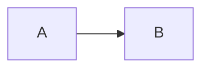
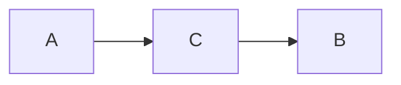

{{/* Structure the implementer follows when writing plan.md. Copy it to .barnraise/documents/plan.md to change it. */ -}}
# Plan for {{.Item.ID}}: {{.Item.Title}}

## Files
The files you will touch, one line each, with what changes in them.

## Steps
Numbered steps, each small enough to commit when it passes.

## Risks
What could break, and how you will notice.

## Verification
For each criterion, how it will be verified (which check, which test).
{{- if eq .DiagramsMode "always"}}

## Before and after
Required. Draw the part of the system this item changes, as it is on main and
as it will be, each as a Mermaid diagram (flowchart, sequenceDiagram,
classDiagram or stateDiagram, whichever shows the change best):

### Before


### After


Keep the two diagrams to the same scope and naming so the difference is what
stands out. For entirely new code, draw only "After".
{{- else if eq .DiagramsMode "auto"}}

## Before and after
Only when the item changes a flow, a structure or a contract that already
exists (not for new code or a small fix): draw the part it changes as it is on
main ("### Before") and as it will be ("### After"), each as a ```mermaid
block (flowchart, sequenceDiagram, classDiagram or stateDiagram). Same scope
and names in both, so the difference stands out. Leave the section out
otherwise.
{{- end}}
